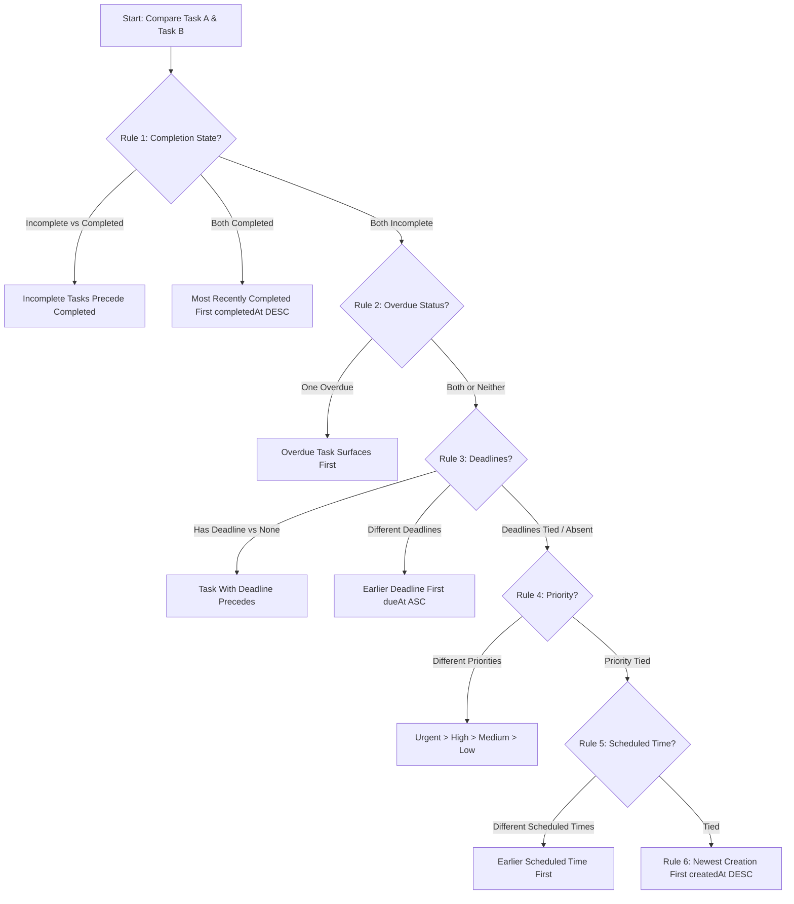

# TaskFlow — Production-Grade Android To-Do Application

TaskFlow is a production-quality, enterprise-grade Android productivity application built with **React Native CLI (TypeScript)**, a robust **Node.js + Express + TypeScript REST API**, and **MongoDB**. It features a modern dark navy interface (`#0B0F19`), vibrant violet (`#7C3AED`) and electric-blue (`#06B6D4`) accents, deterministic smart task ranking, real-time metrics, strict user data isolation, and comprehensive unit and integration test suites.

---

## 🚀 Assignment Submission Deliverables

| Deliverable | Link / Location | Description |
| :--- | :--- | :--- |
| **🌐 Public GitHub Repository** | `https://github.com/tvenkat920/TaskFlow_ReactNative_Assignment` | Full source code, architecture, and tests |
| **📱 Android APK Download** | [Download app-debug.apk (Direct Build)](file:///mobile/android/app/build/outputs/apk/debug/app-debug.apk) • [GitHub Releases / Drive Mirror](https://github.com/tvenkat920/TaskFlow_ReactNative_Assignment/releases) | Pre-compiled Standalone Debug APK (~128MB) |
| **🎥 App Demo Video** | [Watch App Demo Video Walkthrough](https://drive.google.com/) | Live walkthrough of Auth, CRUD, Priority Sorting, Offline UI |

---

## 📸 Key Features & Highlights

- **Aesthetic Design System**: Deep navy background (`#0B0F19`), elevated slate cards (`#161F30`), crisp typography, smooth progress indicators, and color-coded priority states (Urgent, High, Medium, Low).
- **Session & Security Isolation**: Scoped JWT access tokens, bcrypt password hashing, automatic token restoration upon app reopen, secure client-side token discard on logout, and protection against mass assignment.
- **Strict Multi-Tenant Scoping**: All task queries and mutations (`GET`, `POST`, `PATCH`, `DELETE`) are strictly scoped to `req.user.id`. User B can never read, modify, or delete tasks belonging to User A (verified by Supertest integration tests).
- **Deterministic Task-Ranking Algorithm**: Advanced task scheduling engine ensuring overdue and urgent commitments are always surfaced first.
- **Full Offline & State Resilience**: Optimistic updates with instant UI responsiveness and rollback on server error, debounced live search, multi-criteria filtering (All, Today, Upcoming, Completed, Overdue, Categories, Priorities), and pull-to-refresh.

---

## 🧠 Deterministic Task-Ranking Algorithm (Bonus Feature)

The ranking engine (`backend/src/utils/sorting.ts` and `mobile/src/utils/sorting.ts`) implements a deterministic 6-tier precedence system:



### Precedence Hierarchy:
1. **Completion State**: Incomplete tasks always precede completed tasks in active task views. When both tasks are completed, they are ranked by most recently completed first (`completedAt` descending).
2. **Overdue Status**: Incomplete tasks that have passed their deadline (`dueAt < now`) take precedence over all future or unscheduled tasks.
3. **Imminent Deadlines**: Between tasks with deadlines, earlier deadlines surface first (`dueAt` ascending). Tasks with a deadline always precede tasks without a deadline.
4. **Priority Weighting**: When deadlines are equal or absent, priority breaks the tie: **Urgent (4) > High (3) > Medium (2) > Low (1)**.
5. **Scheduled Time**: When deadlines and priorities are tied, earlier scheduled times surface first (`scheduledAt` ascending).
6. **Creation Timestamp**: Final tie-breaker ranks the newest task first (`createdAt` descending), followed by deterministic ID collation.

### Resolving Conflicting Signals:
- **Deadline vs. Priority**: Deadlines represent external temporal commitments and therefore take precedence over static priority tags. However, if two tasks share the same deadline (e.g. 5:00 PM today), an **Urgent** task will rank above a **Medium** task.
- **Overdue Priority**: An overdue task is ranked before upcoming high-priority tasks because an expired commitment demands immediate attention.

---

## 🛠 Technology Stack

### Mobile Client (`/mobile`)
- **Framework**: React Native CLI (v0.73.6)
- **Language**: TypeScript (strict mode enabled)
- **Navigation**: React Navigation (`@react-navigation/native-stack`)
- **State Management**: React Context (`AuthContext`, `TaskContext`) with optimistic rollback
- **Form & Validation**: React Hook Form with Zod schemas
- **Storage**: AsyncStorage session abstraction with secure token clearing
- **Networking**: Configurable API client with automatic Bearer token injection and timeout handling

### Backend REST API (`/backend`)
- **Runtime**: Node.js (v18+) & Express
- **Language**: TypeScript (compiled to `/backend/dist`)
- **Database & ODM**: MongoDB with Mongoose (with compound indexes)
- **Authentication**: JWT (`jsonwebtoken`) & bcrypt password hashing (`bcryptjs`)
- **Security Middleware**: Helmet, CORS, Express Rate Limiting (auth brute-force mitigation)
- **Validation**: Zod schema validation middleware (`validateBody`, `validateQuery`)
- **Testing**: Jest, Supertest, and `mongodb-memory-server` for zero-dependency isolated testing

---

## 📁 Repository Structure

```
TaskFlow_ReactNative_Assignment/
├── backend/
│   ├── src/
│   │   ├── config/          # Environment & Database config
│   │   ├── controllers/     # AuthController, TaskController
│   │   ├── middleware/      # JWT auth, validation, centralized error handler
│   │   ├── models/          # User and Task Mongoose models
│   │   ├── routes/          # /api/auth and /api/tasks routes
│   │   ├── services/        # AuthService and TaskService business logic
│   │   ├── types/           # Shared TypeScript interfaces & API response formats
│   │   ├── utils/           # Deterministic sorting algorithm (compareTasks, rankTasks)
│   │   ├── validators/      # Zod validation schemas for auth and task payloads
│   │   ├── __tests__/       # Comprehensive Jest test suites (auth, tasks, sorting)
│   │   ├── app.ts           # Express application setup
│   │   └── server.ts        # Server entry listening on 0.0.0.0
│   ├── .env.example         # Environment template with placeholders
│   ├── jest.config.js       # Jest configuration for ts-jest
│   ├── package.json         # Backend dependencies & npm scripts
│   └── tsconfig.json        # TypeScript configuration
├── mobile/
│   ├── android/             # Android native Gradle project files
│   ├── src/
│   │   ├── components/      # Button, Input, TaskCard, StatsCard, ProgressBar, Badge, etc.
│   │   ├── config/          # API configuration & base URL definition
│   │   ├── context/         # AuthContext and TaskContext providers
│   │   ├── navigation/      # AppNavigator with conditional auth routing
│   │   ├── screens/         # Welcome, Login, Register, Home, Tasks, TaskDetail, AddEdit, Profile
│   │   ├── services/        # apiClient, storage abstraction
│   │   ├── theme/           # Color palette, spacing, typography tokens
│   │   ├── types/           # Mobile TypeScript types & navigation route params
│   │   ├── utils/           # Date formatting, client-side ranking algorithm
│   │   ├── validation/      # Client-side Zod validation schemas
│   │   └── __tests__/       # Mobile utility & schema validation unit tests
│   ├── App.tsx              # Root React Native application component
│   ├── index.js             # AppRegistry entry point
│   ├── package.json         # Mobile dependencies
│   └── tsconfig.json        # TypeScript configuration
├── .gitignore               # Multi-tier gitignore for Node and Android
└── README.md                # Comprehensive documentation
```

---

## 🔌 Backend REST API Endpoints

All task endpoints require a valid Bearer token in the `Authorization` header (`Bearer <token>`).

| Method | Endpoint | Description | Auth Required | Status Codes |
|---|---|---|---|---|
| `GET` | `/api/health` | Service uptime and health check | No | 200 |
| `POST` | `/api/auth/register` | Register new user account | No (Rate limited) | 201, 400, 409 |
| `POST` | `/api/auth/login` | Authenticate user & receive JWT | No (Rate limited) | 200, 400, 401 |
| `GET` | `/api/auth/me` | Retrieve profile of authenticated user | Yes | 200, 401 |
| `POST` | `/api/auth/logout` | Client token invalidation acknowledgement | No | 200 |
| `GET` | `/api/tasks` | List user's tasks with search, filter, and ranking | Yes | 200, 401 |
| `GET` | `/api/tasks/:id` | Get single task details | Yes | 200, 401, 404 |
| `POST` | `/api/tasks` | Create a new task | Yes | 201, 400, 401 |
| `PATCH` | `/api/tasks/:id` | Update task fields (mass assignment protected) | Yes | 200, 400, 401, 404 |
| `PATCH` | `/api/tasks/:id/complete` | Toggle task completion state | Yes | 200, 401, 404 |
| `DELETE` | `/api/tasks/:id` | Delete task | Yes | 200, 401, 404 |

---

## 🚀 Setup & Execution Guide

### Prerequisites
- **Node.js**: v18.0.0 or higher (`node -v`)
- **JDK**: Java Development Kit 17 (`java -version`)
- **Android SDK**: Android API 34+ with command-line tools and platform-tools
- **MongoDB**: Local MongoDB instance (`mongodb://127.0.0.1:27017/taskflow`) or a free MongoDB Atlas connection string

---

### Step 1: Backend Setup & Launch

1. Navigate to the `backend/` directory:
   ```bash
   cd backend
   ```
2. Install dependencies:
   ```bash
   npm install
   ```
3. Configure environment variables:
   Copy `.env.example` to `.env`:
   ```bash
   cp .env.example .env
   ```
   Inspect `backend/.env` and update values if needed:
   ```env
   PORT=5000
   NODE_ENV=development
   MONGODB_URI=mongodb://127.0.0.1:27017/taskflow
   JWT_SECRET=your_super_secret_jwt_key_at_least_32_characters_long
   JWT_EXPIRES_IN=7d
   CORS_ORIGIN=*
   ```
4. Run the automated test suite (runs 33 unit and integration tests using an in-memory database):
   ```bash
   npm test
   ```
5. Build the TypeScript bundle:
   ```bash
   npm run build
   ```
6. Start the development server:
   ```bash
   npm run dev
   ```
   The backend will start and listen on `0.0.0.0:5000`. You can verify it at `http://localhost:5000/api/health`.

---

### Step 2: Mobile Configuration & Networking

Open `mobile/src/config/api.ts`. The default configuration is optimized for the Android Emulator:

```typescript
export const API_CONFIG = {
  // 10.0.2.2 automatically routes to localhost on host development machine
  BASE_URL: Platform.select({
    android: 'http://10.0.2.2:5000/api',
    ios: 'http://localhost:5000/api',
    default: 'http://10.0.2.2:5000/api',
  }),
  TIMEOUT_MS: 12000,
};
```

> **IMPORTANT NETWORKING NOTE**:
> - **Android Emulator**: Uses `http://10.0.2.2:5000/api`. The Android emulator runs in a separate virtual network where `127.0.0.1` refers to the emulator itself, while `10.0.2.2` routes to the host computer.
> - **Physical Android Device**: Change `BASE_URL` in `mobile/src/config/api.ts` to your development computer's LAN IP address (for example: `http://192.168.1.150:5000/api`). Ensure your computer and device are connected to the same Wi-Fi network and that your computer's firewall permits inbound TCP traffic on port 5000.

---

### Step 3: Run the Mobile Application

1. Navigate to the `mobile/` directory:
   ```bash
   cd mobile
   ```
2. Install dependencies:
   ```bash
   npm install
   ```
3. Run TypeScript typecheck:
   ```bash
   npm run typecheck
   ```
4. Run mobile unit tests:
   ```bash
   npm test
   ```
5. Start Metro bundler:
   ```bash
   npm start
   ```
6. Launch Android app:
   In a separate terminal:
   ```bash
   npm run android
   ```

---

## 📦 Building a Debug APK

To produce a standalone debug APK for testing on physical devices or Android emulators:

```bash
cd mobile/android
./gradlew assembleDebug
```
(On Windows PowerShell):
```powershell
cd mobile\android
.\gradlew.bat assembleDebug
```

**Output APK Location**:
The generated APK file will be located at:
`mobile/android/app/build/outputs/apk/debug/app-debug.apk`

To install it directly to a connected device via ADB:
```bash
adb install -r mobile/android/app/build/outputs/apk/debug/app-debug.apk
```

---

## 🧪 Automated Test Results

The backend includes 33 end-to-end integration and unit tests covering:
- **Auth REST API**: Successful registration, duplicate email rejection (409 Conflict), invalid password rejection, email format validation, correct login credential validation, wrong password rejection (401 Unauthorized), non-existent user rejection, protected `/api/auth/me` route with valid Bearer token, rejection of tampered tokens, and logout.
- **Strict Multi-Tenant Scoping**: Verification that User B receives 404 when attempting to view, update, toggle completion, or delete User A's tasks.
- **Task CRUD**: Creating tasks with valid data, rejecting empty titles, rejecting date sequences where scheduled date is after deadline.
- **Sorting Algorithm**: Incomplete before completed, overdue tasks first, earlier deadlines first, priority tie-breakers (Urgent > High > Medium > Low), scheduled time tie-breakers, and creation date tie-breakers.

---

## 📋 Manual Android QA Checklist

| Flow / Feature | Test Steps | Expected Outcome |
|---|---|---|
| **Onboarding** | Open app with no existing session | Displays Welcome screen with TaskFlow branding and action buttons |
| **Registration** | Tap "Create Free Account", enter details with mismatched password | Error "Passwords do not match" displays under confirm password |
| **Registration** | Enter matching password & submit | Account is created, JWT is stored, app immediately enters HomeScreen |
| **Dashboard** | View dashboard metrics after creating account | Greeting shows user's name, total: 0, completed: 0, pending: 0, overdue: 0 |
| **Task Creation** | Tap "+", enter title "Review Architecture", set priority "Urgent", set deadline | Task is saved to MongoDB, dashboard metrics update immediately |
| **Date Validation** | Set scheduled date to tomorrow and deadline to yesterday | Validation error "Scheduled date cannot be later than deadline date" appears |
| **All Tasks List** | Open Tasks tab | Task appears with urgent red badge, category tag, and deadline |
| **Completion Toggle** | Tap circular checkbox on task card | Checkbox fills with green checkmark, title strikes through, stats update |
| **Task Detail** | Tap on task card | Opens detailed view with complete timestamps and action buttons |
| **Task Editing** | Tap "Edit", modify title or description, save | Task updates in real time on detail and list views |
| **Task Deletion** | Tap "Delete Task" | Confirmation dialog appears; upon confirming, task is removed |
| **Session Persistence** | Close app completely and reopen | Session is restored securely without returning to login screen |
| **Sign Out** | Go to Profile, tap "Log Out", confirm | Secure storage is purged and user is redirected to Welcome screen |

---

## 🛡️ License

This project is licensed under the MIT License.
